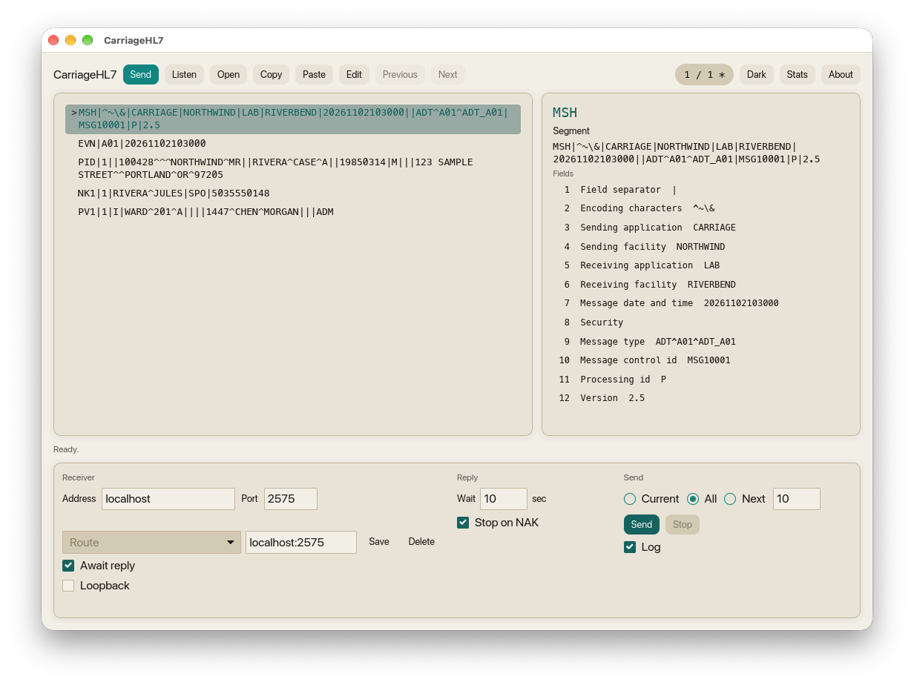
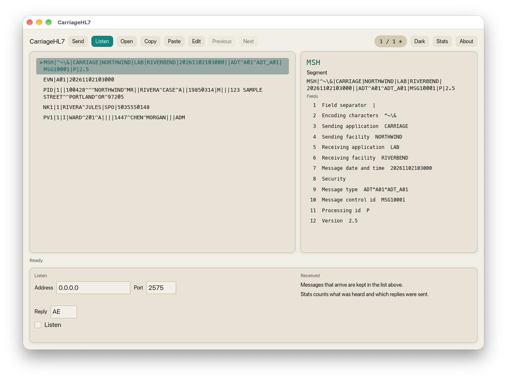

# CarriageHL7

CarriageHL7 sends HL7 v2 messages over MLLP and listens for them. Open a message, read it segment by segment, send it, and answer the messages you receive.

CarriageHL7 for Windows is commercial software, sold in the Microsoft Store. A purchase includes a 30-day trial.

[Get CarriageHL7 for Windows](https://apps.microsoft.com/detail/9MT80L709S60)

The Mac build is an Apple Silicon disk image. Open it and drag CarriageHL7 to Applications. macOS blocks the first launch because the app is not notarized. Control-click CarriageHL7, choose Open, then choose Open again.

[Download CarriageHL7 for Mac](https://github.com/mr-wilson/CarriageHL7/releases/latest/download/CarriageHL7.dmg)

Publisher: Carriage · [Ryan Wilson on LinkedIn](https://www.linkedin.com/in/mrryanwilson/)

## Support

Email [mr.ryanwilson@gmail.com](mailto:mr.ryanwilson@gmail.com).

## Privacy

[Privacy policy](PRIVACY.md)
