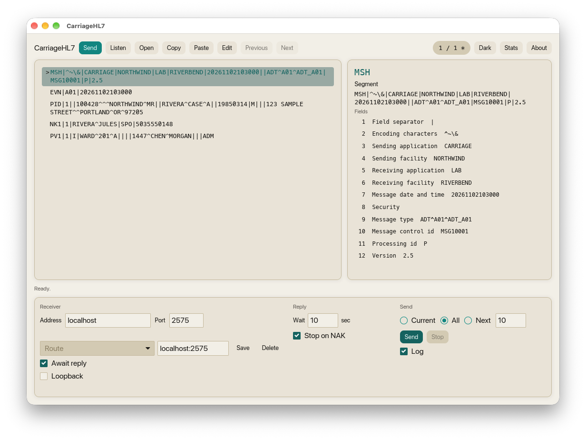
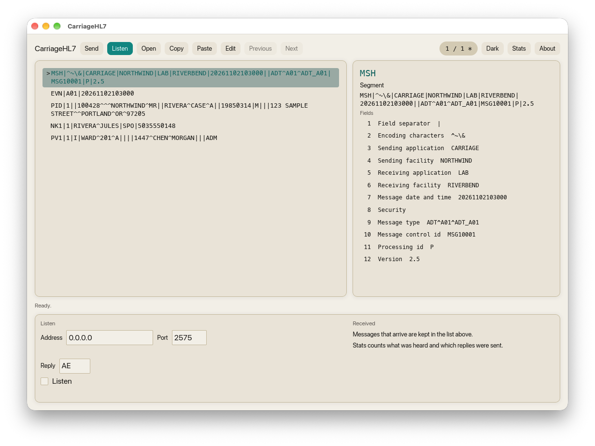

# CarriageHL7

CarriageHL7 sends and receives HL7 v2 over MLLP. Open a file, read it field by field, search it, compare two messages, send, and answer what arrives.

CarriageHL7 for Windows is commercial software, sold in the Microsoft Store. A purchase includes a 30-day trial.

[Get CarriageHL7 for Windows](https://apps.microsoft.com/detail/9MT80L709S60)

The Mac build is an Apple Silicon disk image. Open it and drag CarriageHL7 to Applications. macOS blocks the first launch because the app is not notarized. Control-click CarriageHL7, choose Open, then choose Open again.

[Download CarriageHL7 for Mac](https://github.com/mr-wilson/CarriageHL7/releases/latest/download/CarriageHL7.dmg)

Publisher: Carriage · [Ryan Wilson on LinkedIn](https://www.linkedin.com/in/mrryanwilson/)

## Features

**Read.** Open a file, drop it on the window, or paste. Each segment is a row. The field list shows the path, a short name, and the value. Edits stay in memory. The file on disk is not changed.

**Send.** Send the current message, every message, or the next few. Wait for the acknowledgement, and stop after a reject, a timeout, or a control id that does not match. Save a route for the address, the wait, and TLS. Turn on a local log when you want one.

**Listen.** Received messages stay in their own list. Choose the acknowledgement, or leave Reply empty and the answer follows MSH-15 and MSH-16. The listener can answer at once or after a delay.

**Find.** A plain word matches the control id, message type, sending facility, patient identifier, or patient name. A comparison searches one field, such as `name contains Rivera` or `MSH-9.2 = A01`. Save searches in folders, drag them into place, and combine them with AND or OR. Export the list, or import a JSON file. A query that is already saved is not added again. An empty list starts with a set of common searches.

**Diff.** Compare two messages field by field. Each side can be the message on Send, the message on Listen, a file, or a paste.

**Check and redact.** Check lists missing segments, unknown segments, and broken escapes. Redact copies a message with the identity fields emptied.

TLS uses a certificate and key you choose, for the connection you open or the port you listen on.

## Support

Email [mr.ryanwilson@gmail.com](mailto:mr.ryanwilson@gmail.com).

## Privacy

The app does not create an account and does not send data to Carriage. Settings, saved searches, and the optional log stay on your computer. Messages go only to the address you choose.

[Privacy policy](PRIVACY.md)
